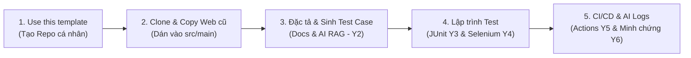
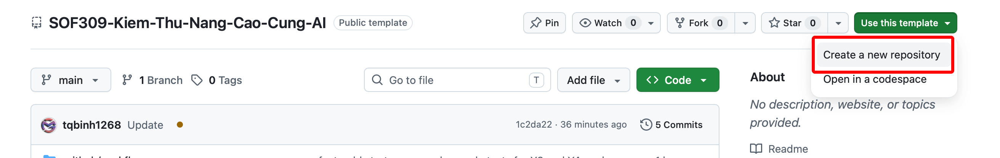
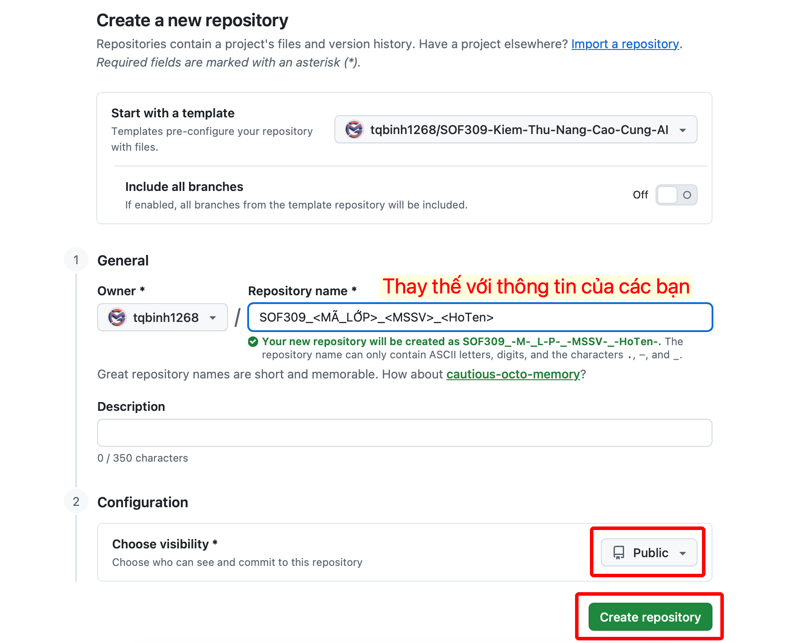
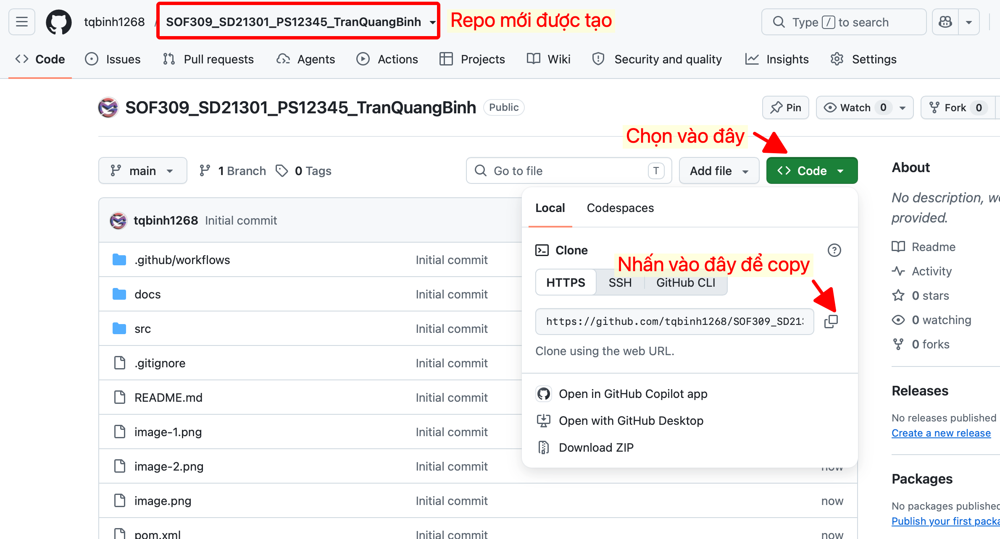

# SOF309: KIỂM THỬ NÂNG CAO CÙNG AI
> **Master Template Assignment dành cho Sinh viên FPT Polytechnic**  
> Giảng viên hướng dẫn: **ThS. Trần Quang Bình (binhtq7 - Thầy Mười Giáo)**  
> 📖 [Xem Cẩm nang hướng dẫn chi tiết từng tuần (Tuần 1 đến Tuần 6)](./docs/HUONG_DAN_CHI_TIET_6_TUAN.md)

---

## 📌 PHẦN I. SƠ ĐỒ LUỒNG THỰC HIỆN (TIMELINE FLOW)



---

## 📅 PHẦN II. LỘ TRÌNH 6 TUẦN THỰC HIỆN ASSIGNMENT & CHECKLIST NỘP BÀI
> *Định hướng Assignment-Centric: Kế thừa toàn bộ kỹ thuật kiểm thử cốt lõi (Parameterized, Exception, Groups, DataProvider, Screenshot on Failure) vào dự án Web thực tế.*

| Tuần & Buổi gặp GV | Trọng tâm kỹ thuật thực hiện | Sản phẩm nghiệm thu trên GitHub | Hạn nộp Google Classroom |
| :---: | :--- | :--- | :--- |
| **Tuần 1**<br>*(02/11 - 08/11)*<br>**Gặp Buổi 1** | • Khởi tạo Repo từ Template của Thầy.<br>• Đưa Web cá nhân vào `src/main/` và chạy mượt local (**Xong Y1**).<br>• Điền đặc tả `SPECIFICATIONS.md`, nạp AI RAG sinh **Test Plan** & **Test Case** (**Xong Y2**). | • Repo chuẩn tên `SOF309_<LỚP>_<MSSV>_<TÊN>`.<br>• Web chạy được local (`localhost:8080`).<br>• File `TEST_PLAN.md` & `TEST_CASES.md`. | **Chủ Nhật (08/11)**<br>Nộp link Repo cá nhân. |
| **Tuần 2**<br>*(09/11 - 15/11)*<br>**Gặp Buổi 2** | • Viết Unit Test cho Controller trong `controllers/` (**Xong Y3**).<br>• **`@ParameterizedTest`** + `@CsvSource` kiểm tra biên Form.<br>• **`assertThrows()`** kiểm thử ngoại lệ bắt lỗi nghiệp vụ. | • Thư mục `src/test/java/.../controllers/`.<br>• Lệnh `mvn test` đạt 100% Pass.<br>• File `docs/ai-logs/01_test_design_ai.md`. | **Chủ Nhật (15/11)**<br>Nộp link commit Unit Test. |
| **Tuần 3**<br>*(16/11 - 22/11)*<br>**Gặp Buổi 3** | • Thiết kế khung **Selenium Page Object Model (POM)** (**Y4 - P1**).<br>• Xây dựng các Page Classes (`LoginPage`, `RegisterPage`, `CrudPage`).<br>• Sử dụng `WebDriverWait` xử lý bất đồng bộ, tương tác DOM. | • Thư mục `src/test/java/.../ui/pages/`.<br>• Kịch bản Selenium mở Chrome chạy mượt mà ở local. | **Chủ Nhật (22/11)**<br>Nộp link commit Selenium POM. |
| **Tuần 4**<br>*(23/11 - 29/11)*<br>**Gặp Buổi 4** | • Nâng cấp **TestNG Framework** chuyên nghiệp (**Y4 - P2**).<br>• Gắn nhãn **`groups = "smoke"`** và ràng buộc `dependsOnMethods`.<br>• **`@DataProvider`** tự động test lặp nhiều tài khoản.<br>• **`ITestListener`** tự động chụp ảnh màn hình khi test fail. | • File cấu hình `testng.xml`.<br>• Thư mục `screenshots/` chứa ảnh lỗi.<br>• File `docs/ai-logs/03_selenium_pom_ai.md`. | **Chủ Nhật (29/11)**<br>Nộp link commit TestNG & Data-Driven. |
| **Tuần 5**<br>*(30/11 - 06/12)*<br>**Gặp Buổi 5** | • Cấu hình CI/CD với **GitHub Actions** (`.github/workflows/test.yml`) (**Xong Y5**).<br>• Chạy test chế độ Chrome Headless trên Ubuntu.<br>• Upload báo cáo kiểm thử & ảnh chụp lỗi lên tab **Artifacts**.<br>• Đưa stack trace lỗi cho AI phân tích debug (Y6). | • Tab **Actions** trên GitHub sáng đèn **Xanh (Pass)**.<br>• Tải được file zip báo cáo trong Artifacts.<br>• File `docs/ai-logs/04_debug_logs_ai.md`. | **Chủ Nhật (06/12)**<br>Nộp link tab GitHub Actions báo Xanh. |
| **Tuần 6**<br>*(07/12)*<br>**Gặp Buổi 6 (Tổng kết)** | • Nhờ AI code review và tối ưu mã nguồn test (Y6).<br>• Rà soát đủ các file trong thư mục `docs/ai-logs/` để **đạt điểm A**.<br>• Chuẩn bị Slide thuyết trình bảo vệ (PowerPoint/PDF). | • Đầy đủ 6 file trong `docs/ai-logs/`.<br>• File nén `.zip` nộp bài lưu trữ.<br>• Slide thuyết trình sẵn sàng bảo vệ. | **Thứ 4 (09/12)**<br>Nộp file zip và Slide bảo vệ. |
| **Tuần 7**<br>*(11/12, 14/12, 16/12)* | **BẢO VỆ ASSIGNMENT CHÍNH THỨC TRƯỚC GIẢNG VIÊN** | • Thuyết trình Slide (3 phút).<br>• Demo test chạy tự động (3 phút).<br>• Vấn đáp trực tiếp với Giảng viên. | **Bảo vệ tại lớp** |

---

## 🚀 PHẦN III. HƯỚNG DẪN 5 BƯỚC TÍCH HỢP WEB CÓ SẴN VÀO REPO

### 🔹 Bước 1: Khởi tạo Repo cá nhân từ Template
1. Tại **góc trên bên phải màn hình** trang này, nhấn nút xanh **Use this template** $\rightarrow$ chọn **Create a new repository**.
2. Điền thông tin biểu mẫu theo quy chuẩn:
   * **Repository name:** `SOF309_<MÃ_LỚP>_<MSSV>_<HọVàTên>` *(Ví dụ: `SOF309_SD21307_PD12345_NguyenVanA`)*
   * **Visibility:** Chọn **Public** (Bắt buộc để Giảng viên truy cập chấm bài).
3. Nhấn nút xanh **Create repository** ở đáy biểu mẫu.

  
*Hình 1: Nhấn nút xanh 'Use this template' ở góc trên bên phải trang GitHub của Thầy.*

---

### 🔹 Bước 2: Clone về máy tính & Chạy thử
1. Tại trang Repo cá nhân vừa tạo, nhấn nút xanh **Code** $\rightarrow$ chọn tab **HTTPS** hoặc **SSH** $\rightarrow$ bấm biểu tượng sao chép URL.

  
*Hình 2: Chọn tài khoản cá nhân và đặt tên Repository đúng quy chuẩn.*

  
*Hình 3: Nhấn nút 'Code' và sao chép đường dẫn Git clone.*

2. Mở Terminal / Git Bash trên máy tính, di chuyển đến thư mục học tập và gõ lệnh:
```bash
git clone https://github.com/<tai-khoan-cua-ban>/SOF309_<MÃ_LỚP>_<MSSV>_<HoTen>.git
```
> 💡 **Repo mẫu thực tế của Thầy để tham khảo:** [https://github.com/tqbinh1268/SOF309_SD21301_PS12345_TranQuangBinh.git](https://github.com/tqbinh1268/SOF309_SD21301_PS12345_TranQuangBinh.git)

---

### 🔹 Bước 3: Đưa Source Web cũ vào dự án
1. Mở thư mục dự án vừa clone bằng IntelliJ IDEA hoặc VS Code.
2. **Copy toàn bộ mã nguồn Web cũ** của bạn (các package Controllers, Services, Models, HTML/JSP...) dán vào thư mục `src/main/java/` và `src/main/resources/`.
3. Mở file `pom.xml`, dán thêm các thư viện cần thiết của web cũ (Spring Boot, MySQL, Thymeleaf...) vào mục `<dependencies>`. File `pom.xml` của Thầy đã cấu hình sẵn **JUnit 5** và **Selenium WebDriver 4**.
4. Khởi động Web và kiểm tra tại `http://localhost:8080` để đảm bảo hệ thống chạy tốt (**Xong Y1**).

---

### 🔹 Bước 4: Viết Test Script & Tài liệu
1. **[Y2] Kế hoạch & Kịch bản Test:** Mở thư mục `docs/` để điền đặc tả `SPECIFICATIONS.md`, kế hoạch `TEST_PLAN.md` và bảng `TEST_CASES.md`.
2. **[Y3] Viết JUnit Test:** Viết các class test cho Controller trong `src/test/java/.../controllers/` (xem file mẫu `SampleControllerTest.java`).
3. **[Y4] Viết Selenium UI Test:** Viết các class Page Object trong `src/test/java/.../ui/pages/` và kịch bản test trong `src/test/java/.../ui/tests/` (xem file mẫu `LoginPage.java` và `LoginTest.java`).
4. **[Y6] Lưu minh chứng AI (Điểm A):** Ghi chép câu lệnh (prompt), code AI sinh và code bạn tự sửa vào các file trong thư mục `docs/ai-logs/`.

---

### 🔹 Bước 5: Đẩy bài lên GitHub & Nộp link
```bash
git add .
git commit -m "feat: complete assignment automation tests"
git push origin main
```
* **Kiểm tra kết quả:** Truy cập tab **Actions** trên GitHub. Workflow tự động chạy và hiển thị dấu tích **Xanh lá cây (Pass)** (**Xong Y5**).
* **Nộp bài:** Sao chép đường link GitHub Repo của bạn nộp vào **Google Classroom** của lớp.

---

## 📁 PHẦN IV. CẤU TRÚC THƯ MỤC QUY CHUẨN CỦA DỰ ÁN

```text
SOF309_<MÃ_LỚP>_<MSSV>_<HoTen>/
├── pom.xml                               # Đã tích hợp sẵn JUnit 5 & Selenium 4
├── testng.xml                            # File điều phối chạy Suite, Groups & Listeners
├── .github/
│   └── workflows/
│       └── test.yml                     # [Y5] Tự động chạy test khi push code
├── docs/                                # [Y2 & Y6] Tài liệu & Minh chứng AI
│   ├── HUONG_DAN_CHI_TIET_6_TUAN.md     # Cẩm nang hướng dẫn chi tiết từng tuần
│   ├── SPECIFICATIONS.md                # [Y1] Đặc tả nghiệp vụ Web cá nhân
│   ├── TEST_PLAN.md                     # [Y2] Kế hoạch kiểm thử
│   ├── TEST_CASES.md                    # [Y2] Bộ kịch bản Test Case chi tiết
│   └── ai-logs/                         # [Y6] Minh chứng tương tác AI (Điểm A)
│       └── README.md
├── src/
│   ├── main/                            # [Y1] Mã nguồn Web cá nhân của sinh viên
│   │   ├── java/
│   │   └── resources/
│   └── test/java/com/poly/sof309/
│       ├── controllers/                 # [Y3] Unit Test cho Controller (Parameterized, Exception)
│       │   └── SampleControllerTest.java
│       └── ui/                          # [Y4] Selenium UI Test (Page Object Model)
│           ├── pages/                   # Các class Page Object (LoginPage.java...)
│           │   └── LoginPage.java
│           └── tests/                   # Kịch bản test chạy trên trình duyệt (Data-Driven, Groups)
│               └── LoginTest.java
├── screenshots/                         # [Y4 & Y5] Thư mục tự động lưu ảnh chụp khi test fail
├── .gitignore
└── README.md
```

---

## 🎯 PHẦN V. BẢNG TIÊU CHÍ ĐÁNH GIÁ (RUBRIC Y1 - Y6)

| Hạng điểm | Yêu cầu hoàn thành | Chi tiết nghiệm thu |
| :---: | :--- | :--- |
| **A (8.0 - 10.0)** | **Y1 đến Y6** | • Hoàn thành toàn bộ test JUnit và Selenium.<br>• Pipeline GitHub Actions báo xanh.<br>• **Bắt buộc:** Đầy đủ các file minh chứng trong `docs/ai-logs/` và vấn đáp bảo vệ tốt. |
| **B (7.0 - 7.9)** | **Y1 đến Y5** | • Web chạy tốt, có kịch bản test, JUnit, Selenium và CI/CD Actions chạy pass (thiếu hoặc chưa hoàn chỉnh minh chứng AI Y6). |
| **C (5.0 - 6.9)** | **Y1 đến Y3** | • Web chạy được, có Test Plan/Test Case và chạy được Unit test JUnit (chưa làm Selenium UI và CI/CD). |
| **D (< 5.0)** | **Dưới 3 yêu cầu** | • Không hoàn thành đủ các yêu cầu cơ bản $\rightarrow$ **Học lại**. |
