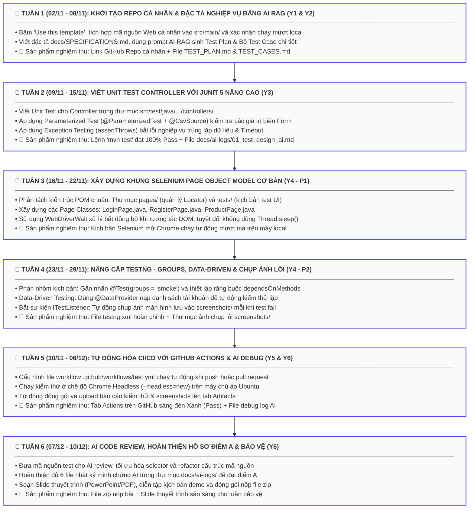

# CẨM NANG HƯỚNG DẪN CHI TIẾT 6 TUẦN THỰC HIỆN ASSIGNMENT
## MÔN HỌC: SOF309 - KIỂM THỬ NÂNG CAO CÙNG AI
> **Phương pháp tiếp cận:** *Assignment-Centric (Tập trung toàn lực vào Assignment)*  
> **Kế thừa tinh hoa:** Tích hợp toàn bộ kỹ thuật kiểm thử cốt lõi từ 8 bài Lab của môn Kiểm thử nâng cao vào dự án Web cá nhân  
> **Giảng viên hướng dẫn:** ThS. Trần Quang Bình (binhtq7 - Thầy Mười Giáo)

---

## 📌 PHẦN I. TỔNG QUAN LỘ TRÌNH 6 TUẦN (MACRO VIEW)



---

## PHẦN II. HƯỚNG DẪN CHI TIẾT TỪNG TUẦN (STEP-BY-STEP)

---

### 🟢 TUẦN 1: KHỞI TẠO REPO, TÍCH HỢP WEB CŨ (Y1) & THIẾT KẾ TEST BẰNG AI (Y2)
* **Thời gian:** 02/11 – 08/11/2026
* **Mục tiêu hoàn thành:** Xong trọn vẹn **Y1** và khởi động **Y2**.

#### 1. Các bước thực hiện:
* **Bước 1.1:** Truy cập Repo của Thầy: [https://github.com/tqbinh1268/SOF309-Kiem-Thu-Nang-Cao-Cung-AI](https://github.com/tqbinh1268/SOF309-Kiem-Thu-Nang-Cao-Cung-AI). Nhấn nút xanh **Use this template** $\rightarrow$ đặt tên Repo `SOF309_<MÃ_LỚP>_<MSSV>_<HọTên>` ở chế độ **Public**.
* **Bước 1.2:** Clone repo về máy cá nhân và mở bằng IntelliJ IDEA / VS Code.
* **Bước 1.3 (Tích hợp Web cũ):**
  * Copy toàn bộ code Web Java từ kỳ trước dán vào: `src/main/java/` và `src/main/resources/`.
  * Mở `pom.xml`, dán bổ sung các dependency của web cũ (Spring Boot, MySQL, Thymeleaf...).
  * Khởi động web và kiểm tra tại `http://localhost:8080`: Xác nhận Đăng ký, Đăng nhập và ít nhất 1 chức năng CRUD hoạt động bình thường (**Xong Y1**).
* **Bước 1.4 (Đặc tả nghiệp vụ):** Mở file `docs/SPECIFICATIONS.md`, mô tả chi tiết:
  * URL các màn hình (`/login`, `/register`, `/products`).
  * Danh sách các trường dữ liệu và ràng buộc validation (độ dài, ký tự đặc biệt, giá > 0...).
* **Bước 1.5 (Ứng dụng AI + RAG):** Copy nội dung `docs/SPECIFICATIONS.md` gửi cho AI (ChatGPT/Claude/Gemini) với prompt:
  > *"Bạn là QA Lead. Dưới đây là đặc tả nghiệp vụ dự án Web của tôi: [Dán nội dung]. Hãy áp dụng kỹ thuật Phân vùng tương đương và Phân tích giá trị biên để thiết kế Test Plan và Bộ Test Case chi tiết cho Controller và UI."*
* **Bước 1.6:** Lưu kết quả vào `docs/TEST_PLAN.md`, `docs/TEST_CASES.md` và lưu câu lệnh prompt vào `docs/ai-logs/01_test_design_ai.md`.

#### 2. Tiêu chí nghiệm thu Tuần 1:
- [ ] Repo cá nhân hiển thị trên GitHub đúng tên chuẩn.
- [ ] Ứng dụng Web khởi động thành công ở local không bị lỗi.
- [ ] Có đầy đủ 3 file: `docs/SPECIFICATIONS.md`, `docs/TEST_PLAN.md` và `docs/TEST_CASES.md`.
- [ ] **Hạn nộp Google Classroom:** Chủ Nhật (08/11) - Nộp link GitHub Repo cá nhân.

---

### 🟢 TUẦN 2: VIẾT UNIT TEST CONTROLLER VỚI JUNIT 5 NÂNG CAO (Y3)
* **Thời gian:** 09/11 – 15/11/2026
* **Mục tiêu hoàn thành:** Xong trọn vẹn **Y3** (Toàn bộ Unit test cho Controller chạy pass 100%).
* **Kỹ thuật kế thừa từ môn cũ:** Parameterized Test (Lab 2), Exception Testing & Timeout (Lab 3).

#### 1. Các bước thực hiện:
* **Bước 2.1:** Mở thư mục `src/test/java/com/poly/sof309/controllers/`. Tạo các class test tương ứng với Controller của web (Ví dụ: `AuthControllerTest.java`, `ProductControllerTest.java`).
* **Bước 2.2 (Áp dụng Parameterized Test kiểm tra biên form - Lab 2 cũ):**
  Thay vì viết nhiều hàm test lặp lại, sử dụng `@ParameterizedTest` kết hợp `@CsvSource` để quét qua hàng loạt bộ dữ liệu hợp lệ và không hợp lệ:
  ```java
  @ParameterizedTest
  @DisplayName("Kiểm tra validation đăng ký tài khoản với nhiều bộ dữ liệu biên")
  @CsvSource({
      "'', 'password123', false, 'Username không được để trống'",
      "'user', 'password123', false, 'Username phải từ 5 đến 20 ký tự'",
      "'validUser', '123', false, 'Mật khẩu phải từ 8 ký tự'",
      "'validUser', 'Pass@1234', true, 'Đăng ký thành công'"
  })
  public void testRegisterValidation(String username, String password, boolean expectedSuccess, String message) {
      boolean actualResult = authService.validateRegister(username, password);
      assertEquals(expectedSuccess, actualResult, message);
  }
  ```
* **Bước 2.3 (Áp dụng Exception Testing - Lab 3 cũ):**
  Kiểm tra hệ thống ném ra ngoại lệ chính xác khi vi phạm nghiệp vụ (ví dụ: đăng ký tài khoản đã tồn tại, nhập giá âm):
  ```java
  @Test
  @DisplayName("Ném ngoại lệ DuplicateUserException khi tài khoản đã tồn tại")
  public void testRegisterDuplicateUserThrowsException() {
      assertThrows(DuplicateUserException.class, () -> {
          authService.registerExistingAccount("admin");
      });
  }
  ```
* **Bước 2.4 (Áp dụng Timeout Testing):** Thêm `@Timeout(value = 2, unit = TimeUnit.SECONDS)` để kiểm tra các hàm xử lý dữ liệu không bị treo vòng lặp vô tận.
* **Bước 2.5 (Minh chứng AI):** Ghi chép prompt sinh unit test vào `docs/ai-logs/02_junit_script_ai.md`.

#### 2. Tiêu chí nghiệm thu Tuần 2:
- [ ] Chạy lệnh `mvn test -Dtest=*ControllerTest` tại Terminal: Kết quả báo **BUILD SUCCESS (100% Pass, không có Failure hay Error)**.
- [ ] Có áp dụng `@ParameterizedTest` và `assertThrows()`.
- [ ] **Hạn nộp Google Classroom:** Chủ Nhật (15/11) - Nộp link commit chứa mã nguồn Unit Test.

---

### 🟢 TUẦN 3: XÂY DỰNG SELENIUM PAGE OBJECT MODEL CƠ BẢN (Y4 - PHẦN 1)
* **Thời gian:** 16/11 – 22/11/2026
* **Mục tiêu hoàn thành:** Xây dựng khung tự động hoá giao diện Web bằng Selenium WebDriver theo mô hình chuẩn **Page Object Model (POM)**.

#### 1. Các bước thực hiện:
* **Bước 3.1 (Tạo các Page Classes):** Tại thư mục `src/test/java/com/poly/sof309/ui/pages/`, tạo các class đại diện cho từng trang:
  * `LoginPage.java`: Chứa các `By locator` (username, password, nút login) và hàm hành động `login(user, pass)`.
  * `RegisterPage.java`: Chứa locator các trường đăng ký và hàm `register(...)`.
  * `ProductPage.java`: Chứa locator form thêm mới, sửa, xóa sản phẩm và bảng dữ liệu.
* **Bước 3.2 (Tối ưu Locator & Wait):**
  * Ưu tiên dùng `By.id()`, `By.name()`. Nếu dùng XPath thì dùng XPath tương đối (ví dụ: `//button[@type='submit']`).
  * Sử dụng **`WebDriverWait`** để chờ phần tử sẵn sàng bấm (tránh dùng `Thread.sleep()` gây đơ luồng test):
    ```java
    WebDriverWait wait = new WebDriverWait(driver, Duration.ofSeconds(10));
    WebElement btn = wait.until(ExpectedConditions.elementToBeClickable(btnLogin));
    btn.click();
    ```
* **Bước 3.3 (Tạo Test Scripts):** Tại thư mục `src/test/java/com/poly/sof309/ui/tests/`, viết class chạy test thực tế:
  * `LoginTest.java`: Mở trình duyệt, nhập tài khoản và assert URL sau đăng nhập.
  * `CrudTest.java`: Tự động điền form thêm 1 bản ghi mới và assert thông báo thành công.

#### 2. Tiêu chí nghiệm thu Tuần 3:
- [ ] Chạy test Selenium ở máy local: Trình duyệt Chrome tự động bật lên, tự gõ phím, tự click chuột và hoàn thành luồng không bị crash.
- [ ] Tách biệt rõ ràng: Không viết chung Locator lẫn lộn trong Test Class (Bắt buộc tuân thủ POM).
- [ ] **Hạn nộp Google Classroom:** Chủ Nhật (22/11) - Nộp link commit phần Selenium cơ bản.

---

### 🟢 TUẦN 4: TESTNG NÂNG CAO - DATA-DRIVEN, GROUPS & CHỤP ẢNH LỖI (Y4 - PHẦN 2)
* **Thời gian:** 23/11 – 29/11/2026
* **Mục tiêu hoàn thành:** Nâng cấp kịch bản Selenium thành một Test Framework chuyên nghiệp, hoàn tất trọn vẹn **Y4**.
* **Kỹ thuật kế thừa từ môn cũ:** Test Groups & Phụ thuộc (Lab 5), DataProvider (Lab 6), Chụp ảnh lỗi & Listener (Lab 8).

#### 1. Các bước thực hiện:
* **Bước 4.1 (Phân nhóm Test Groups & Ràng buộc phụ thuộc - Lab 5 cũ):**
  * Gắn nhãn `@Test(groups = "smoke")` cho các ca kiểm thử then chốt: Đăng nhập hợp lệ, Hiển thị danh sách sản phẩm.
  * Gắn nhãn `@Test(groups = "regression")` cho các ca kiểm thử phụ: Kiểm tra lỗi form, xóa sản phẩm...
  * Sử dụng `dependsOnMethods`: Luồng sửa/xóa sản phẩm chỉ chạy sau khi luồng thêm mới thành công:
    ```java
    @Test(groups = "regression", dependsOnMethods = {"testCreateProductSuccess"})
    public void testDeleteProduct() { ... }
    ```
* **Bước 4.2 (Data-Driven Testing với `@DataProvider` - Lab 6 cũ):**
  Nạp danh sách tài khoản để tự động kiểm thử đăng nhập hàng loạt:
  ```java
  @DataProvider(name = "loginAccounts")
  public Object[][] getLoginData() {
      return new Object[][] {
          {"admin", "123456", true},
          {"admin", "wrongPass", false},
          {"lockedUser", "123456", false}
      };
  }

  @Test(dataProvider = "loginAccounts", groups = "smoke")
  public void testLoginDataDriven(String user, String pass, boolean isExpectedSuccess) {
      loginPage.login(user, pass);
      // Assert kết quả tương ứng...
  }
  ```
* **Bước 4.3 (Tự động chụp ảnh màn hình khi Test thất bại - Lab 8 cũ):**
  Tạo class `TestListener` implements `ITestListener` để tự động lưu ảnh vào `screenshots/` mỗi khi có test fail:
  ```java
  public class TestListener implements ITestListener {
      @Override
      public void onTestFailure(ITestResult result) {
          TakesScreenshot ts = (TakesScreenshot) DriverManager.getDriver();
          File src = ts.getScreenshotAs(OutputType.FILE);
          File dest = new File("screenshots/" + result.getName() + "_" + System.currentTimeMillis() + ".png");
          FileUtils.copyFile(src, dest);
      }
  }
  ```
* **Bước 4.4:** Tạo file `testng.xml` ở thư mục gốc để quản lý toàn bộ các Suite và Listener trên.

#### 2. Tiêu chí nghiệm thu Tuần 4:
- [ ] Chạy file `testng.xml`: Toàn bộ kịch bản chạy tuần tự, test fail tự động có ảnh chụp trong thư mục `screenshots/`.
- [ ] Có file nhật ký `docs/ai-logs/03_selenium_pom_ai.md`.
- [ ] **Hạn nộp Google Classroom:** Chủ Nhật (29/11) - Nộp link commit chứa `testng.xml` và code Data-Driven.

---

### 🟢 TUẦN 5: TỰ ĐỘNG HÓA CI/CD VỚI GITHUB ACTIONS & DEBUG CÙNG AI (Y5 & Y6)
* **Thời gian:** 30/11 – 06/12/2026
* **Mục tiêu hoàn thành:** Xong trọn vẹn **Y5** (Pipeline chạy xanh trên GitHub) và thu thập minh chứng Debug AI (Y6).
* **Kỹ thuật kế thừa từ môn cũ:** Xuất báo cáo kiểm thử lên máy chủ (Lab 8 cũ).

#### 1. Các bước thực hiện:
* **Bước 5.1 (Cấu hình Headless Chrome):** Đảm bảo class thiết lập WebDriver có hỗ trợ cờ headless khi chạy trên môi trường CI:
  ```java
  ChromeOptions options = new ChromeOptions();
  if (System.getenv("CI") != null) {
      options.addArguments("--headless=new");
      options.addArguments("--no-sandbox");
      options.addArguments("--disable-dev-shm-usage");
  }
  ```
* **Bước 5.2 (Cấu hình GitHub Actions `.github/workflows/test.yml`):**
  Khai báo workflow tự động chạy group `smoke` và upload báo cáo lên Artifacts:
  ```yaml
  name: CI Automation Test Suite
  on: [push, pull_request]

  jobs:
    test:
      runs-on: ubuntu-latest
      steps:
      - name: Checkout Code
        uses: actions/checkout@v4

      - name: Set up JDK 17
        uses: actions/setup-java@v4
        with:
          java-version: '17'
          distribution: 'temurin'
          cache: maven

      - name: Run Smoke Tests
        run: mvn clean test -Dgroups=smoke

      - name: Upload Test Report & Screenshots
        if: always()
        uses: actions/upload-artifact@v4
        with:
          name: test-execution-results
          path: |
            target/surefire-reports/
            screenshots/
  ```
* **Bước 5.3 (Thu thập minh chứng Debug bằng AI - Y6):**
  Mỗi khi gặp lỗi văng Exception (ví dụ: `ElementClickInterceptedException`, `TimeoutException`), sao chép đoạn log lỗi đó gửi cho AI. Lưu nội dung phân tích vào `docs/ai-logs/04_debug_logs_ai.md`.

#### 2. Tiêu chí nghiệm thu Tuần 5:
- [ ] Đẩy code lên GitHub $\rightarrow$ Tab **Actions** hiển thị dấu tích **Xanh lá cây (Success)**.
- [ ] Tải được file zip `test-execution-results` trong mục Artifacts của GitHub Actions.
- [ ] Có file nhật ký `docs/ai-logs/04_debug_logs_ai.md` và `docs/ai-logs/05_github_actions_ai.md`.
- [ ] **Hạn nộp Google Classroom:** Chủ Nhật (06/12) - Nộp link tab GitHub Actions sáng xanh.

---

### 🟢 TUẦN 6: AI CODE REVIEW, HOÀN THIỆN HỒ SƠ ĐIỂM A & BẢO VỆ (Y6)
* **Thời gian:** 07/12 – 10/12/2026
* **Mục tiêu hoàn thành:** Hoàn thiện 100% hồ sơ dự thi, sẵn sàng bước vào tuần bảo vệ đạt điểm 8.0 - 10.0.

#### 1. Các bước thực hiện:
* **Bước 6.1 (AI Code Review):** Gửi toàn bộ code kiểm thử cho AI yêu cầu review và tối ưu mã nguồn (ví dụ: tối ưu selector, bỏ code thừa, refactor cấu trúc). Ghi nhận nhật ký vào `docs/ai-logs/06_code_review_ai.md`.
* **Bước 6.2 (Kiểm tra hồ sơ minh chứng AI):** Đảm bảo thư mục `docs/ai-logs/` có đủ các file:
  * `01_test_design_ai.md`
  * `02_junit_script_ai.md`
  * `03_selenium_pom_ai.md`
  * `04_debug_logs_ai.md`
  * `05_github_actions_ai.md`
  * `06_code_review_ai.md`
* **Bước 6.3 (Soạn Slide thuyết trình):** Tạo file PowerPoint (tối đa 10 - 12 slides):
  * Slide 1: Thông tin sinh viên & Đề tài Web.
  * Slide 2: Kiến trúc kiểm thử (JUnit + Selenium POM + TestNG + CI/CD).
  * Slide 3: Kế hoạch kiểm thử & Bảng ma trận Test Case (Y2).
  * Slide 4: Kết quả chạy Unit Test & Parameterized Test (Y3).
  * Slide 5: Kịch bản Automation UI Selenium & Data-Driven (Y4).
  * Slide 6: Kết quả chạy trên GitHub Actions (Y5).
  * Slide 7: Minh chứng và trải nghiệm làm việc với AI (Y6).
* **Bước 6.4 (Đóng gói nộp bài):**
  Nén toàn bộ source code thành file zip: `<MSSV>_<HoTen>_SOF309_Assignment.zip` và nộp lên hệ thống theo yêu cầu của Giảng viên.

#### 2. Tiêu chí nghiệm thu Tuần 6:
- [ ] Toàn bộ 6 thẻ task trên GitHub Projects Board đã chuyển sang cột **Done**.
- [ ] Slide thuyết trình và file nén đã chuẩn bị sẵn sàng.
- [ ] **Hạn nộp cuối cùng:** Thứ 4 (09/12) - Nộp file zip và Slide trên Google Classroom / LMS.

---

## 🏆 TUẦN 7: BẢO VỆ ASSIGNMENT CHÍNH THỨC (11/12, 14/12, 16/12)
* Sinh viên trình chiếu Slide (3 - 5 phút).
* Chạy demo trực tiếp test script trên máy local và chiếu tab Actions trên GitHub (3 phút).
* Trả lời câu hỏi vấn đáp của Giảng viên về:
  1. *Cách phân tích giá trị biên trong Test Case của bạn.*
  2. *Giải thích cấu trúc Page Object Model và cách tổ chức Locator.*
  3. *Chỉ ra điểm nào AI làm sai mà bạn đã tự tay chỉnh sửa lại.*

